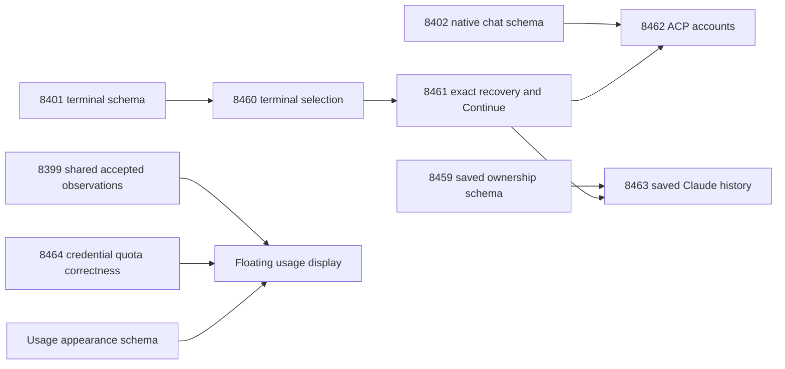

# Account and shared usage integration

Reviewed against upstream `e80bcf08c62f4c696c81227e6714603aff72b62e`. Each feature PR targets `main`; prerequisites are identified explicitly so its diff shrinks as those foundations land.

The source recorded in `qualification.json` also combines the independent composer acceptance and watcher readiness fixes. The existing fork review branch preserves that combined source; it is not another feature PR.

The independent account and usage stacks touch two shared files. Their tested composition keeps the strict credential readers from the usage stack and the structural account/routing guards from the account stack. Catalogs retain both additions. The terminal form retains all four modes (`start`, `resume`, `chat`, `browse`) and their distinct submit labels. Watcher assertions require actual delivered event paths, rather than only internal map growth. No producer wiring was added by these resolutions.

Final integration checks exposed and corrected two actual compatibility defects: extended history ownership evidence was incorrectly included in a six-field scan comparison, and command authorization mistook its own verified reserved successor for a competing writer. Regressions retain the complete ownership proof and continue to reject changed histories, mismatched successors and competing writers. Exact event assertions for two Codex exit fixtures are isolated from the separately tested delayed startup reporter.

The full test command bounds Bun worker concurrency for this loaded development machine. It preserves the existing product deadlines and records the runner timeout explicitly. Initial integration failures and their corrections are retained in the private audit; passing local tests do not replace hosted checks, maintainer review or the CLA.

The UI images and recordings use actual components, controller and preload with synthetic accounts/transport. They prove layout and interaction; authenticated provider replay is a separate claim. The native Continue receipt covers one owned Claude Code 2.1.310 background worker on macOS arm64. ACP account switching, Linux/x64, physical multi-display and sleep/wake are not claimed as live-qualified.

The unqualified native Claude session producer is excluded. Personal account-registry/onboarding, authentication renewal, distribution, project folders and additional import sources remain separate slices. These PRs do not claim complete parity with every feature of the personal app.
