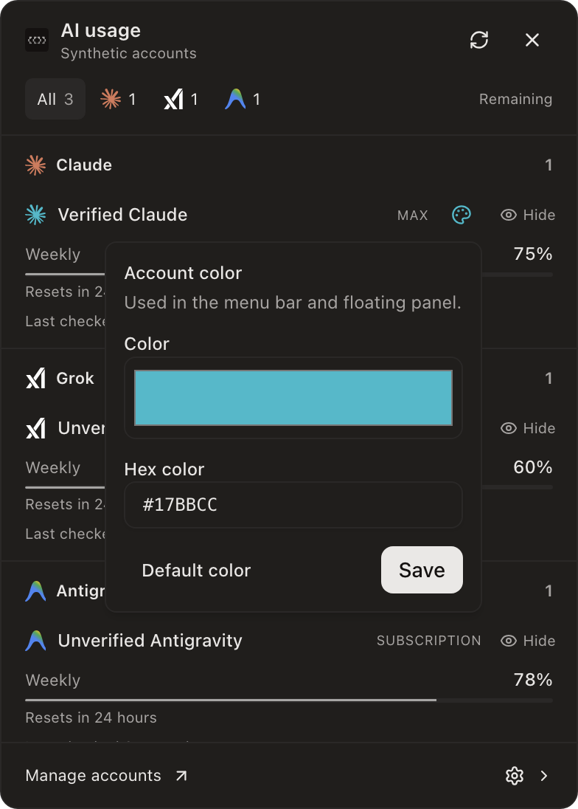
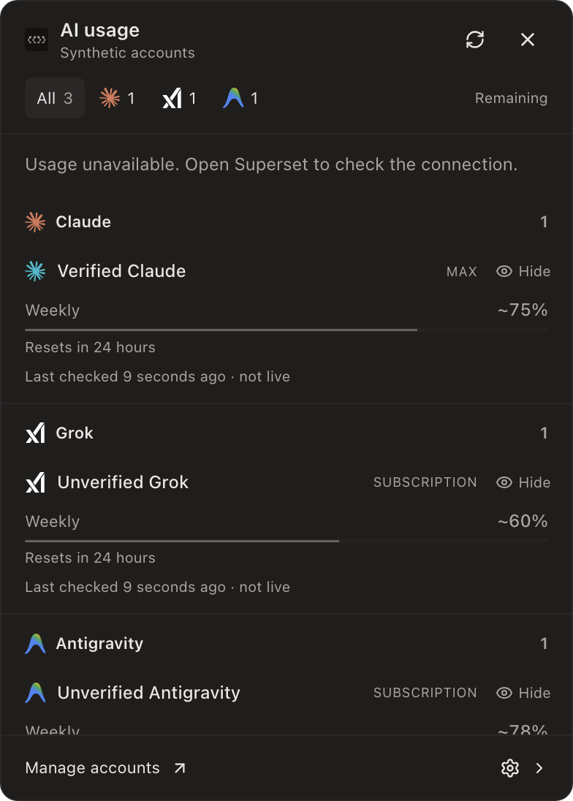
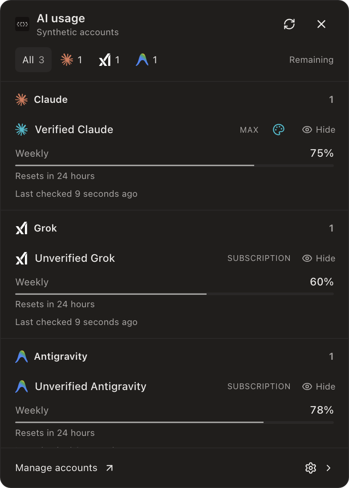

# Review follow-up verification

Tested against upstream `d962fd0f2d529d935cb2bd7fde9691f2e374a717`. Nine existing PRs are updated; no new PR or review request is created.

The 18 outstanding inline threads were assessed: 12 unique valid findings fixed, five already covered, one duplicate inherited from its prerequisite. All 25 review-body notes have an individual disposition in [findings.json](findings.json).

Fixes cover prompt acknowledgement and cancellation, forced shared quota refresh, host-scoped attribution authority, ordinary resume discovery, failed background attachment recovery, safe quota projection, Node test registration, historical outage display, optional-read deadlines, verified appearance identities, startup ordering, development CSP and translation plurals.

The Keychain timeout suggestion remains unproven. No measured timeout or official recommended replacement bound supports changing it inside the shared capture deadline. The strict credential refusal remains. Translations name the actual software edge panel rather than a physical screen cutout.

## Verification

- The whole workspace Bun run completed with one failure in the unchanged shell descriptor-count assertion (expected 11, observed 8). Its test, implementation and shell resolver match upstream byte for byte. Cause is unproven; no clean-upstream runtime reproduction or whole-suite success is claimed. The assertion was not weakened and the failed run was not retried away.
- Isolated i18n tests, full typecheck, lint, strict catalog extraction/compilation and real Node/PTY integration checks pass.
- Each proposed PR head has its own applicable runtime/UI/type checks and lint. The appearance migration and Codex quota Node tests run through their registered task paths.
- Normal test deadlines are unchanged. Earlier failures and qualification bounds are recorded in [qualification.json](qualification.json).
- Current-source hidden Electron tests cover verified color writes, refused unverified writes, retained outage values/dates/colors and recovery. Screenshots use synthetic accounts; no production provider replay is claimed.
- The first native run hit the documented Node24.21 cleanup-hook crash. One comparison using already-installed Node24.22.1, the same source and ABI137 addon passed 60 cases with two existing fish skips. No rebuild, dependency change or product runtime change was made. See [native-runtime.json](native-runtime.json).
- Actual Vite/React transform and loopback HMR connection/reload passed. Packaged CSP stayed unchanged. See [ui-proof.json](ui-proof.json).
- No dependency, lockfile, database migration or native ABI changes. Existing published branch history is preserved.
- Production apps, running chats and servers were not operated or restarted. Hosted CI authorization and human review remain separate.

## Exact proposed heads

| PR | Commit |
| --- | --- |
| [#8400](https://github.com/superset-sh/superset/pull/8400) | `6b1e4e5b8b3a6858c35eb2b06f1f370f7a64f607` |
| [#8460](https://github.com/superset-sh/superset/pull/8460) | `4c2da2f47a1c1fb2074f368ef5b2f1f14705f5c5` |
| [#8461](https://github.com/superset-sh/superset/pull/8461) | `66239d502606ed018840a942cb311172b9816143` |
| [#8462](https://github.com/superset-sh/superset/pull/8462) | `6ef0839d035c5c19f5ef23a837d6531934736d41` |
| [#8463](https://github.com/superset-sh/superset/pull/8463) | `b382cee00d2fcca54a1bd03d5e66204cdc64c831` |
| [#8464](https://github.com/superset-sh/superset/pull/8464) | `537290bc5662b4b8d4ee705bfa5a992ed50c20c2` |
| [#8883](https://github.com/superset-sh/superset/pull/8883) | `bb3b54708ee2dc84f4a4ec074d441b5aa8dfc493` |
| [#8884](https://github.com/superset-sh/superset/pull/8884) | `3212a4daeb3283b1286d9e4ab6756c59ec1e0e20` |
| [#8888](https://github.com/superset-sh/superset/pull/8888) | `8ce2ec1b0fb5e785793bde8234c5d927be9cb9c3` |

## Current UI evidence

Verified account color controls:

Retained readings during a transport outage:

Normal menu:

