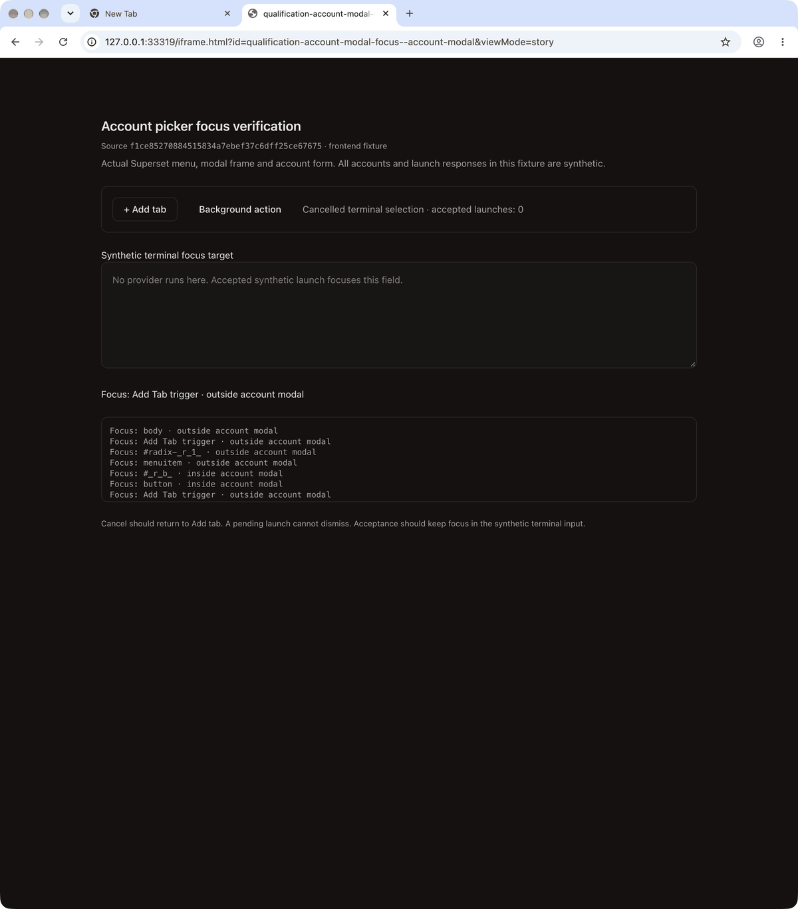
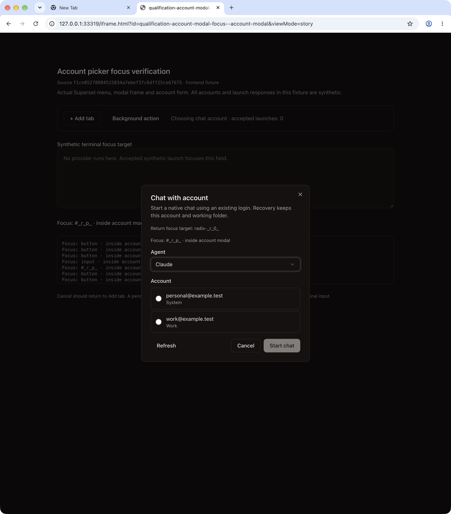
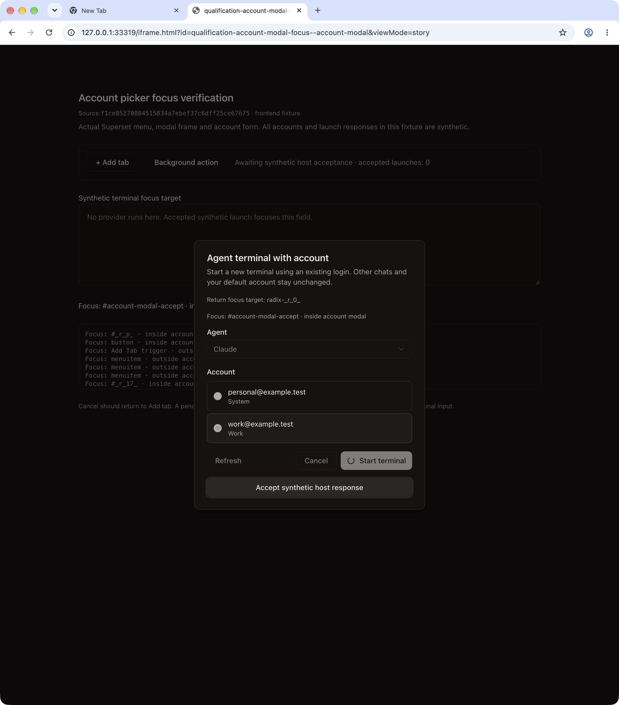
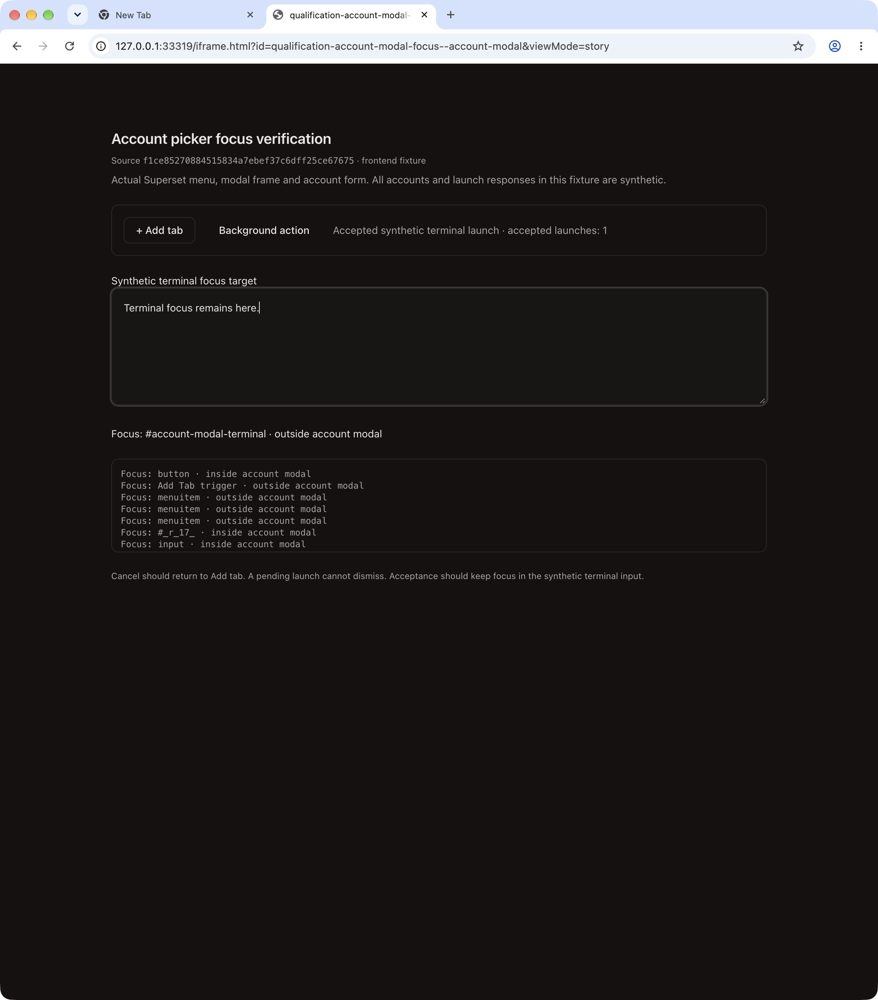

# Account picker focus checks

**Passed within component scope.** These are the actual `AddTabMenu`, `AccountTerminalDialogFrame` and `AccountTerminalForm`, with synthetic accounts and controlled launch responses. Source: `f1ce85270884515834a7ebef37c6dff25ce67675`.

- Both terminal and native-chat pickers retained focus through 12 forward and 12 reverse Tab presses.
- Cancel returned focus to the Add Tab trigger. Return reopened its menu.
- Pending launches ignored Escape, disabled Cancel and fields, and removed Close.
- Accepted responses closed the picker and preserved focus in the synthetic target. Typed text confirmed it. The nested Codex selector also worked.

The walkthrough contains ten actual CUA screenshot keyframes over 18 seconds, not a continuous recording. It is resized and GIF quantized; the original PNGs below are unchanged.

All identities use reserved synthetic `.test` addresses. The unrelated shortcut label is an inert stub to avoid Electron IPC. The launch target is a textarea; no provider, terminal or backend runs. **This demonstrates frontend behavior, not authenticated provider replay or full desktop E2E.** [Structured proof](proof.json) records the source hashes, journeys and asset hashes.
